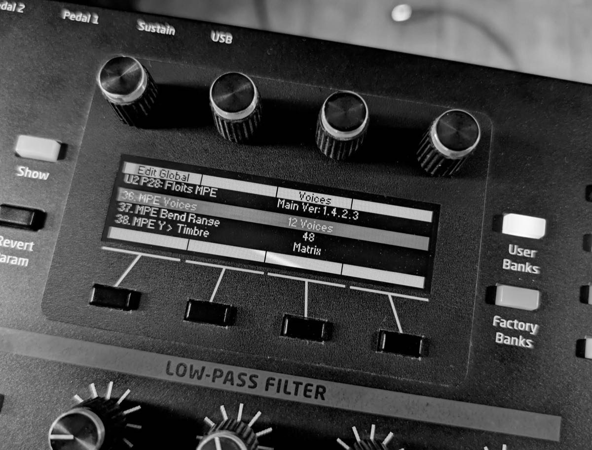
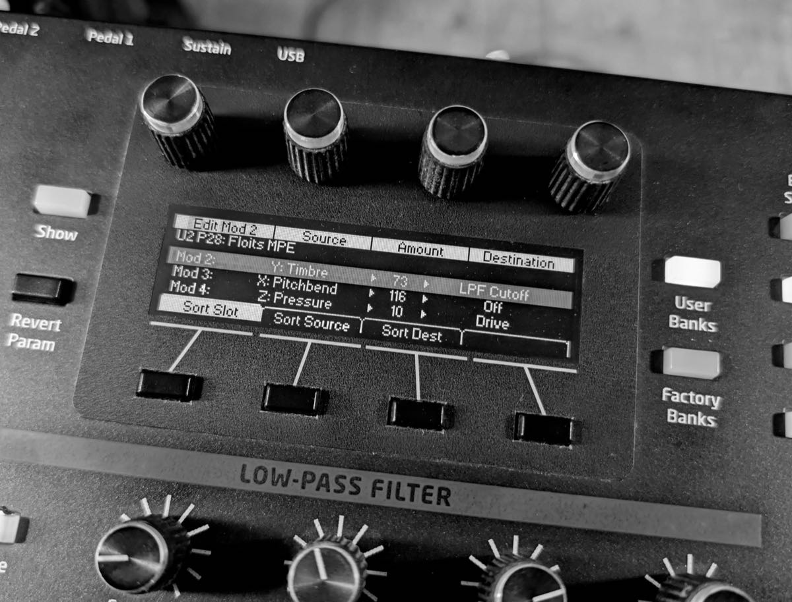

# P12 M

**P12 M** (repository `p12-mod`) is an unofficial firmware modification for the Sequential (Dave Smith
Instruments) Prophet 12 keyboard, Main OS 1.4.2.3. It adds **MPE** (MIDI Polyphonic
Expression): per-note pitch bend, pressure and timbre (Y, CC74) from an MPE
controller such as a LinnStrument, with up to twelve independent voices.

This repository holds **source code and build tools only**. It contains no
firmware image and no Sequential code. You build the modified update yourself
from the official `P12_Keyboard_Main_1.4.2.3.syx` that you download from
Sequential; the build checks that file's hash first.

> [!WARNING]
> **Unofficial, experimental firmware — use at your own risk.** This project is
> not affiliated with or endorsed by Sequential, and it is provided **as-is,
> with no warranty** (see the [MIT licence](LICENSE)).
>
> - Installing it **replaces the operating system of your Prophet 12.** If
>   something goes wrong, you may have to restore the official OS, and in the
>   worst case open the instrument and reprogram its processor with an ICSP
>   programmer.
> - It also **changes the program of the six DSPs.** Test it at **low volume
>   and without headphones** the first time: faulty DSP code can produce
>   full-scale noise.
> - It has been tested on **one unit only.**
> - **Back up your programs first** (SysEx dump), and read
>   [Recovery](#recovery) before you install anything. Make sure you can send
>   a SysEx file to the Prophet 12 over 5-pin MIDI.
>
> You are responsible for what you install on your instrument.

## Why

I had been dreaming about this for a long time. Since it had almost no chance
of ever showing up in an official firmware, I did it myself: full MPE support
for the Prophet 12, from an external controller. The Prophet 12 already
responded to poly aftertouch, but I really missed per-voice pitch bend, and
CC74 was hardwired to the cutoff.

I've owned my Prophet 12 since it came out. The following year I bought a
LinnStrument, and both instruments are very dear to me; I'm a big MPE fan.
More recently I got an Osmose, and I'm thrilled to be able to play the
Prophet 12, still my favourite synth, with it.

My first version only changed the main processor (the PIC32). That gave six
independent MPE voices in Normal mode, but only three in Stack mode, which was
a bit disappointing. After more digging into the DSP code, it now reaches
twelve independent MPE voices, and six in Stack mode.

**How it was made.** Yes, the code was written by AI (Claude, through
Claude Code), under my direction: I set the goals, made the design decisions
and reviewed the results. All hardware testing was done by me, on my own
Prophet 12, including the exact build this repository produces.

## What it adds

- **MPE Lower Zone:** manager channel 1, member channels 2 and up. The zone
  size follows the MPE Configuration Message (RPN 6) sent by the controller.
- **Per-note expression:** pitch bend, pressure (Z) and CC74 (Y) per note.
  Manager-channel pressure and CC74 apply to the whole zone.
- **Voices:** `Single` (six notes, one per DSP), `Pair` (six notes, two
  voices each) or `12 Voices` (twelve independent notes, with per-voice bend,
  pressure and Y in the DSP code).
- **Y as a mod source:** `MPE Y > Timbre` routes Y per note to the matrix
  source shown as `Y: Timbre`, optionally also to the low-pass cutoff.
- **Stack and Split** programs and the **arpeggiator** with per-note MPE, or a
  fallback that plays MPE notes as ordinary notes.
- Eight new rows in the **Global** menu, also reachable over **NRPN**.
- The three MPE dimensions are named in the mod matrix: `X: Pitchbend`,
  `Y: Timbre`, `Z: Pressure`.

<p>
   Timbre set to Matrix">
  
</p>

*The MPE rows of the Global menu, and the X / Y / Z sources in the mod matrix.*

## What's next

MPE is the first part of P12 M. I'm working on more tools that will join it
later, played directly on the instrument: an onboard randomizer that varies a
program section by section (oscillators, filter, envelopes, modulation...), a
morph between two stored programs, and other helpers for sound design. They
already run on my Prophet 12, but they are not ready to share yet.

## Settings

The rows follow the stock Global menu rows (rows 35 to 42). They are saved
with the other Global settings when you leave the Global menu.

| Row | NRPN | Setting | Values | Default |
| --- | --- | --- | --- | --- |
| 35 | 433 | MPE Mode | Off, On | On |
| 36 | 434 | MPE Voices | Single, Pair, 12 Voices | 12 Voices |
| 37 | 435 | MPE Bend Range | Program, 1-96 semitones | 48 |
| 38 | 436 | MPE Y > Timbre | Off, Matrix, Matrix+Cut | Matrix+Cut |
| 39 | 437 | MPE Pitch Wheel | Bend All, Off | Bend All |
| 40 | 438 | MPE Fallback | Play, Silent | Play |
| 41 | 439 | MPE Stack/Split | Fallback, MPE | MPE |
| 42 | 440 | MPE Arp | Per-note, Fallback | Per-note |

- `12 Voices` needs a fixed bend range; with `Program` it behaves as `Single`.
- `MPE Fallback` decides what programs that cannot use MPE do with MPE notes
  (`Play`: as ordinary notes with the latest note's expression).
- Set the controller's pitch-bend range to the same value as `MPE Bend Range`
  (48 by default).
- `tools/mpe_nrpn.py` sets these over MIDI from a computer.

## Build

Requirements: Python 3.9 or later, and Docker (for the GNU MIPS cross
compiler; a native `mips-linux-gnu-gcc` on `PATH` also works).

1. Download the official Prophet 12 Main OS **1.4.2.3** update from Sequential
   and put `P12_Keyboard_Main_1.4.2.3.syx` in `firmware/official/releases/1.4.2.3/`.
   Its SHA-256 must be
   `502715feb43236e880a97567a30b35809fea277b9eecc7de89c4a664c64e4583`.
2. Build the compiler image once:

   ```sh
   docker build -t p12-gnu-mips tools/gnu_mips
   ```

3. Extract the PIC32 image, then build the modified update:

   ```sh
   python3 -m tools.unpack_main_os firmware/official/releases/1.4.2.3/P12_Keyboard_Main_1.4.2.3.syx firmware/extracted/P12_Main_1_4_2_3.bin
   python3 -m tools.make_mpe_image firmware/extracted/P12_Main_1_4_2_3.bin firmware/patched \
       --dsp-voice-bend --dsp-outer-blocks --xyz-source-names --name p12-mod
   ```

   The extracted image must have SHA-256
   `16c20113783115798ffd2db8ec67ae62599b1aa9a5483d89f97d61d071ad2c45`;
   the build refuses any other input. It checks every patched site against
   the expected original code and writes `firmware/patched/p12-mod.syx`.
4. Run the tests (optional): `python3 -m unittest discover -s tests`.

Do not share the files in `firmware/`: they contain Sequential's firmware.

## Install

Send `p12-mod.syx` to the Prophet 12 over **5-pin MIDI (DIN)**, the same way
as an official OS update (see the Prophet 12 manual, "Updating the
Operating System"). Test at low volume the first time, without headphones.

## Recovery

- **Back to stock:** send the official `P12_Keyboard_Main_1.4.2.3.syx` over
  DIN, as for any OS update.
- **Last resort:** if the unit no longer accepts an update, the PIC32 can be
  rewritten with an ICSP programmer (for example a Microchip Snap) on the
  board's programming header, from a full flash read made beforehand. This
  needs opening the instrument and some electronics experience.
- The six SHARC DSPs keep no program of their own: they receive it from the
  PIC32 at every boot, so restoring the OS also restores them.

## Known limits

- Only Main OS 1.4.2.3, keyboard version.
- Tested on one unit, with a LinnStrument and an Osmose. Larger bend ranges than 48 are
  untested.
- Design and reverse-engineering notes referenced in source comments as
  `research/...` are not published yet.

## Licence

MIT, see [LICENSE](LICENSE). It covers the code in this repository only, not
Sequential's firmware that the build modifies. "Prophet 12" and "Sequential"
are trademarks of their owners and are used here only to say which instrument
this modification is for.
